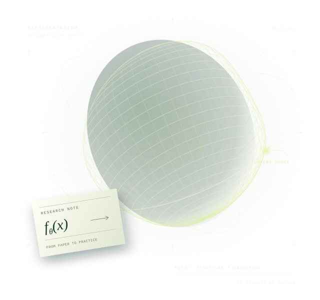

```{=html}
<section class="research-hero awards-hero" aria-labelledby="hero-title">
  <div class="hero-rail"><span><i class="status-mark" aria-hidden="true"></i>LIBOK03 / RESEARCH JOURNAL</span><button id="motion-toggle" class="motion-toggle" type="button" aria-pressed="true" hidden>모션 켜짐 <span aria-hidden="true">Ⅱ</span></button></div>
  <div class="hero-stage">
    <div class="hero-copy">
      <p class="hero-overline">A CLOSER LOOK AT THE IDEAS.</p>
      <h1 id="hero-title" class="hero-wordmark"><span>PAPER</span><em>notes<span class="wordmark-dot">.</span></em></h1>
      <p class="hero-kicker">논문의 아이디어를,<br>구현의 언어로.</p>
      <p class="hero-description">수식 너머의 직관, 코드 안의 선택.<br>연구자와 개발자를 위한 깊이 있는 읽기 기록.</p>
      <div class="hero-actions"><a class="research-button" href="#archive-heading">리뷰 둘러보기 <span aria-hidden="true">↗</span></a><a class="quiet-link" href="about.html">이 기록에 대하여 <span aria-hidden="true">↗</span></a></div>
    </div>
    <figure class="hero-art"><div class="art-orbit" aria-hidden="true"></div><div class="art-orbit art-orbit--inner" aria-hidden="true"></div><svg class="art-signal" viewBox="0 0 640 600" aria-hidden="true" focusable="false"><path d="M 98 364 C 10 232 239 69 432 127 C 646 191 590 419 382 443 C 213 463 110 420 98 364 Z"/></svg><figcaption><span>FIG. 01 — THE SHAPE OF UNDERSTANDING</span><span>IDEA → LOGIC → CODE</span></figcaption></figure>
  </div>
  <div class="hero-baseline"><p>INDEPENDENT NOTES.<br>CONNECTED IDEAS.</p><a class="hero-scroll" href="#archive-heading"><span>SCROLL TO EXPLORE</span><span aria-hidden="true">↓</span></a></div>
</section>
<section class="research-topics" aria-label="관심 연구 분야"><span class="topic-label">AREAS OF CURIOSITY</span><span><small>01</small>Autonomous Driving</span><span><small>02</small>Robotics</span><span><small>03</small>Reinforcement Learning</span></section>
<section class="archive-heading" id="archive-heading"><div><p class="research-eyebrow">01 / SELECTED READING</p><h2>읽고 남긴 <em>기록.</em></h2><p>문제 정의에서 연산과 구현까지, 한 편씩 깊게.</p></div><label class="archive-search"><svg aria-hidden="true" width="18" height="18" viewBox="0 0 24 24" fill="none" stroke="currentColor" stroke-width="1.5"><circle cx="10" cy="10" r="6.5"/><path d="m15 15 5 5"/></svg><input id="paper-search" type="search" placeholder="제목이나 주제로 찾기" aria-label="논문 리뷰 검색"></label></section>
```

::: {#paper-archive}
:::

```{=html}
<p id="paper-search-empty" hidden class="archive-empty">검색어와 일치하는 리뷰가 없습니다.</p>
<section class="reading-principles" aria-labelledby="principles-title">
  <div class="principles-intro"><p class="research-eyebrow">02 / THE READING METHOD</p><h2 id="principles-title">이해는 세 번의<br><em>질문에서 시작된다.</em></h2><p>요약을 넘어, 동작하는 이유까지.</p></div>
  <div class="principle"><div class="principle-top"><span>01 / DEFINE</span><span class="principle-symbol" aria-hidden="true">[ x ]</span></div><h3>어떤 문제인가.</h3><p>무엇을 입력받고 무엇을 예측하는가.<br>가정과 표현부터 명확하게 짚습니다.</p><span class="principle-label">PROBLEM & REPRESENTATION</span></div>
  <div class="principle"><div class="principle-top"><span>02 / TRACE</span><span class="principle-symbol" aria-hidden="true">f(x)</span></div><h3>어떻게 동작하는가.</h3><p>모듈 사이의 데이터 흐름과 수식을<br>코드의 계산 순서에 연결합니다.</p><span class="principle-label">METHOD & IMPLEMENTATION</span></div>
  <div class="principle"><div class="principle-top"><span>03 / VERIFY</span><span class="principle-symbol" aria-hidden="true">∴</span></div><h3>무엇이 근거인가.</h3><p>실험과 ablation을 읽고,<br>확인한 사실과 해석을 구분합니다.</p><span class="principle-label">EVIDENCE & LIMITATIONS</span></div>
</section>
<section class="research-outro" aria-labelledby="outro-title"><p class="research-eyebrow">STILL READING. STILL LEARNING.</p><div><h2 id="outro-title">Keep asking <em>why.</em></h2><a href="about.html" class="outro-link" aria-label="이 기록에 대하여"><span aria-hidden="true">↗</span></a></div><p>좋은 질문이 다음 기록의 시작이 됩니다.</p></section>
<div class="research-colophon"><span>READ. DECODE. BUILD.</span><span>PERSONAL NOTES BY LIBOK03</span><a href="#hero-title">BACK TO TOP ↑</a></div>
```
